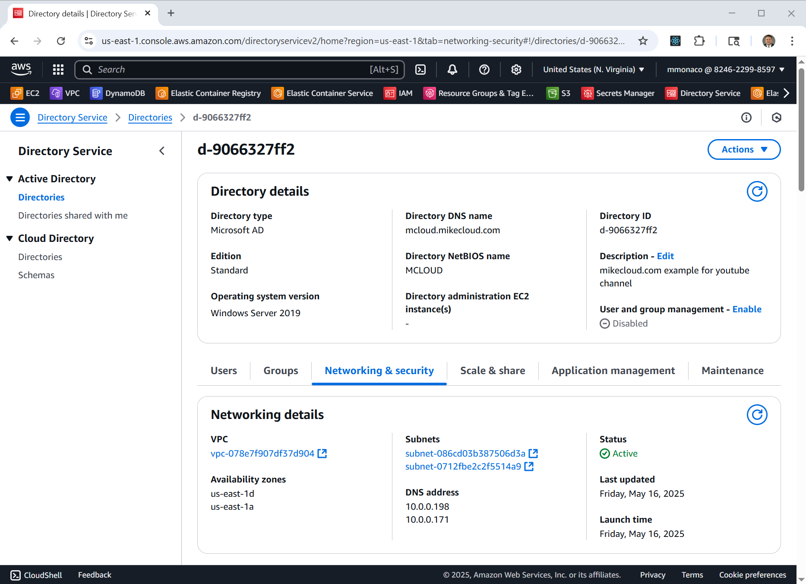

# AWS Managed Microsoft AD (AWS Directory Service)

Part 1 of the series
[Deploying Active Directory in the Cloud](https://youtu.be/H5lKJPJBL5s).
Terraform builds **AWS Managed Microsoft AD**, AWS's fully managed Active
Directory, then a Linux and a Windows instance that join the domain at boot.
The Windows instance also creates the lab's users and groups, with the POSIX
attributes Linux needs.

| Piece | Where | Role |
|---|---|---|
| **AWS Managed Microsoft AD** | `ad-subnet-1` / `ad-subnet-2` (us-east-2a, us-east-2b) | Standard edition, domain `mcloud.mikecloud.com` / `MCLOUD`; two AWS-managed domain controllers; the VPC's DHCP options point DNS at them |
| **linux-ad-instance** | `vm-subnet-1` | Ubuntu 24.04, `t2.micro`; joins with `realm` and SSSD; SSH with AD passwords |
| **windows-ad-instance** | `vm-subnet-1` | Windows Server 2022, `t2.medium`; joins the domain; installs RSAT; creates the AD groups and users |
| **Secrets Manager** | regional | `admin_ad_credentials_ds` and `<user>_ad_credentials_ds` |
| **NAT gateway** | public subnet | outbound internet for the AD subnets |

## Architecture

<picture>
  <source media="(prefers-color-scheme: dark)" srcset="architecture-dark.svg">
  
</picture>

Regenerate with `python3 make_diagram.py`.

- **`01-directory/`**: the VPC (`directory-vpc`, 10.0.0.0/24) with two
  public VM subnets and two private AD subnets, the NAT gateway, the
  directory and its DHCP options, and the AD passwords in Secrets Manager.
- **`02-servers/`**: the Linux and Windows instances, their IAM role (SSM
  plus read access to the AD secrets), and security groups.

## How the members join

AWS creates the directory's `Admin` account, with Domain Admin rights, using
the password Terraform stores in `admin_ad_credentials_ds`.

1. **Windows**: installs RSAT and the AWS CLI, reads the admin secret, and
   joins with `Add-Computer`. It then creates the groups and, from each
   user's secret, the users, each with a `uidNumber` and `gidNumber`; adds
   `MCLOUD\mcloud-users` to Remote Desktop Users; and reboots. It skips
   anything that already exists, so it's safe to re-run.
2. **Linux**: reads the admin secret and joins with `realm join`. SSSD is set
   for short names and the POSIX IDs stored in AD; SSH accepts passwords;
   home directories are created on first login; `linux-admins` get
   passwordless sudo.

| User | Groups | uidNumber | sudo on Linux |
|---|---|---|---|
| jsmith | mcloud-users, us, linux-admins | 10001 | yes |
| edavis | mcloud-users, us | 10002 | no |
| rpatel | mcloud-users, india, linux-admins | 10003 | yes |
| akumar | mcloud-users, india | 10004 | no |

| Group | gidNumber |
|---|---|
| mcloud-users | 10001 |
| india | 10002 |
| us | 10003 |
| linux-admins | 10004 |

Every user's primary `gidNumber` is 10001 (`mcloud-users`). Linux sees users
only once they have these attributes, which is why the Windows host sets
them.

## Security groups

```
internet ─22, 443───▶ linux-ad-instance
internet ─3389, 443─▶ windows-ad-instance
```

`ad-ssh-security-group`, `ad-rdp-security-group` and
`ad-ssm-security-group` allow those ports from `0.0.0.0/0`; every login still
needs an AD account. The domain controllers have no public address. Both
instances are also reachable through **SSM Session Manager**.

## Prerequisites

* [An AWS Account](https://aws.amazon.com/console/)
* [Install AWS CLI](https://docs.aws.amazon.com/cli/latest/userguide/getting-started-install.html)
* [Install Terraform](https://developer.hashicorp.com/terraform/install)
* [Install jq](https://jqlang.github.io/jq/download/)

If this is your first time watching our content, we recommend starting with
this video: [AWS + Terraform: Easy Setup](https://youtu.be/BCMQo0CB9wk).

## Deploy

```bash
git clone https://github.com/mamonaco1973/aws-active-directory.git
cd aws-active-directory
./apply.sh       # 1: VPC + Managed AD + secrets  2: Linux and Windows instances
```

Everything deploys to `us-east-2`. Phase 1 takes **30–60 minutes**, almost
all of it AWS creating the directory. After phase 2, the Windows instance
needs several minutes to join, create the users and reboot; the Linux
instance can't resolve AD users until they exist. `apply.sh` ends by running
`validate.sh`, which prints the directory's ID, stage and DNS addresses, and:

```
NOTE: Windows RDP Host FQDN: ec2-203-0-113-10.us-east-2.compute.amazonaws.com
NOTE: Linux SSH Host FQDN:  ec2-203-0-113-20.us-east-2.compute.amazonaws.com
```

## Try it

1. Get a user's password:

   ```bash
   aws secretsmanager get-secret-value --secret-id jsmith_ad_credentials_ds \
     --query SecretString --output text | jq -r .password
   ```

2. Look at the directory in the console under **Directory Service**:

   

   

3. RDP to the **Windows RDP Host** as `MCLOUD\jsmith`. **Active Directory
   Users and Computers** shows the users and groups the instance created.

   

4. SSH to the **Linux SSH Host** as `jsmith`. Try `id`,
   `getent group linux-admins` and `sudo -l`.

   

## Troubleshooting

| Symptom | Fix |
|---|---|
| Phase 1 seems stuck | Creating a Managed AD directory takes 30–60 minutes. |
| `id jsmith` finds nothing on Linux | The Windows instance hasn't created the users yet; wait for it to reboot. SSSD caches lookups; `sudo sss_cache -E` clears it. |
| SSH rejects every AD password | `aws ssm start-session --target <instance-id>`, then `sudo tail /root/userdata.log`. |

## Teardown

```bash
./destroy.sh     # destroys the instances, deletes the AD secrets, destroys the directory and VPC
```

## Notes

- **Lab only.** SSH and RDP are open to the internet, and both joins use the
  domain `Admin` account. Restrict the security groups and use a dedicated
  join account for anything more.
